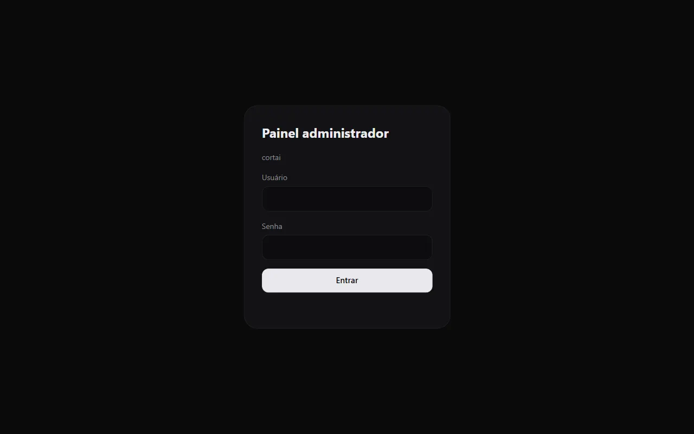

<!-- readme-padrao -->
# Cortaí

> Cola o link de um vídeo longo (YouTube, Instagram, TikTok) e recebe os cortes virais prontos: vertical, legenda grande, gancho e relatório de por que cada corte pode viralizar. Também faz tela dividida e clona o estilo de um Reels. Start R$ 19,90, Pro R$ 29,90, Turbo R$ 59,90.


## O que é
Cola o link de um vídeo longo (YouTube, Instagram, TikTok) e recebe os cortes virais prontos: vertical, legenda grande, gancho e relatório de por que cada corte pode viralizar. Também faz tela dividida e clona o estilo de um Reels. Start R$ 19,90, Pro R$ 29,90, Turbo R$ 59,90.

Estado: **no ar**. Produto da Rangel Tech, vendido pela Cakto (conta do Lucas). Registro único dos produtos: `vps_rt_infra/registro/produtos.yml` (spec 57).

## Onde está no ar
- https://cortai.rangeltech.net

**Painel do administrador:** `https://cortai.rangeltech.net/admin` (login único dos produtos; a credencial está no Infisical, `rt-produtos/_admin`).



O usuário de teste (QA) de cada produto é obtido no painel único (`painel.rangeltech.net`, aba do produto).

## Onde faz o deploy
Este repositório **só publica** o artefato; **quem implanta é o `vps_rt_infra`** (nenhum container é trocado à mão).

1. Publicar a release: criar a tag (`v*`); o workflow `.github/workflows/release.yml` gera a imagem e o `release-manifest.json` e publica como release.
2. Implantar (de madrugada, 00h às 06h de Brasília): `gh workflow run deploy.yml --repo RangelTech/vps_rt_infra -f service=cortai`
   - Só validar, sem implantar: acrescentar `-f dry_run=true`.
3. Voltar uma versão (rollback): `gh workflow run deploy.yml --repo RangelTech/vps_rt_infra -f service=cortai -f version=<tag-antiga>`.

O serviço no mapa de releases é `cortai` (`vps_rt_infra/releases/sources.json`).

## Como funciona por dentro
- **API e site:** FastAPI (Python) em `app/`, com a landing em `static/`. Container único (`Dockerfile`).
- **Dados:** hoje SQLite no volume do container; **está planejada a migração** para o banco `produtos` do Postgres (um schema por produto) e dos arquivos para o MinIO (spec 57, seções 8 e 8.6).
- **IA:** fala com o Qwen pelo `llm-access` (chave por produto).
- **Cobrança:** webhook da Cakto (`/api/cakto` ou rota equivalente) libera o plano; a conciliação diária compara pedidos e assinaturas.
- **Login:** hoje por código no e-mail; passa para e-mail e senha com captcha invisível e "entrar por link" (spec 57, seção 5A).

## Segredos
Só os **nomes** das variáveis estão neste repositório, em [`segredos.yml`](segredos.yml). Os **valores** ficam no Infisical (projeto `rt-produtos`, ambiente `prod`, pasta `cortai`) e chegam à VPS **gerados no momento do deploy**. Nunca coloque valor de segredo no git.

## Rodar e testar localmente
```bash
python -m venv .venv && source .venv/bin/activate   # no Windows: .venv\Scripts\activate
pip install -r requirements.txt
pytest
```
Os testes de QA em produção são por cliques reais (relatório em PDF no `new_ragente/qa/evidencias`).

## Links
- Painel único: https://painel.rangeltech.net (aba do produto: links, usuário de QA, planos)
- Spec de organização geral: `new_ragente/specs/57_ORGANIZACAO_GERAL_PRODUTOS_E_PAINEL.md`
- Monitor: Uptime Kuma, `cortai`

## Notas técnicas (README anterior)

# Cortaí

Site de cortes virais (spec 38 B do ecossistema Rangel Tech): cole o link de um vídeo e receba cortes verticais com legenda, gancho e relatório.

- `app/`: FastAPI (login por código no e-mail, fila de trabalhos, webhook da Cakto) e o pipeline (yt-dlp, transcrição pelo llm-access, escolha dos trechos pela IA, ffmpeg).
- `static/`: página de vendas e painel.
- Deploy: somente pelo `RangelTech/vps_rt_infra` (stack `cortai`). Release: workflow `Release` com a versão.
- Segredos: `/opt/platform/secrets/cortai.env` na VPS (`CORTAI_LLM_KEY`, `CORTAI_SEGREDO_SESSAO`, SMTP, Cakto).

Teste local: `CORTAI_DEV=1 CORTAI_DADOS=./dados uvicorn app.main:app` (o código de login aparece na resposta).
